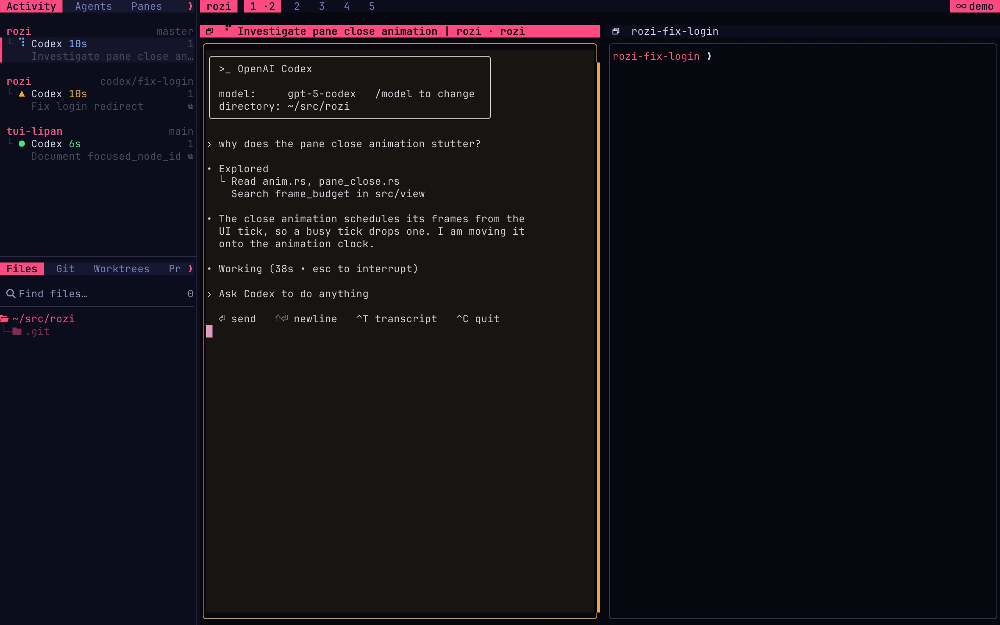

# codex-rozi-sessions

Codex runs its threads in a shared background server, and a Codex client keeps the threads it
switched away from loaded there, often each in its own Git worktree. rozi sees that client as a
single pane. This extension lists every loaded thread as its own row in that pane, so rozi's
Activity sidebar and Agents view show each one's state under the repository and branch it works
in. Selecting a row switches the client to that thread.



## Requirements

- rozi 0.0.36 or newer, on the client and on every host you attach sessions on
- Codex 0.160 or newer, with its background server (`codex app-server daemon`), which Codex starts
  on its own unless you run it with `--no-daemon`
- Python 3 available as `python3`, and `codex`, on each host that runs Codex
- Linux or macOS. See [Limits](#limits).

The extension runs on the machine of each attached session, including a remote one attached with
`rozi --remote`, beside that machine's Codex background server. Install it once, on the client;
rozi copies it to the host.

## Install

From rozi's **Extensions…** palette entry, open the **Discover** tab and install
`codex-rozi-sessions`. Or use the CLI:

```bash
rozi extensions install https://github.com/tui-lipan/codex-rozi-sessions.git
rozi run-action reload-extensions
```

Later releases can be applied with `rozi extensions update codex-rozi-sessions`.

Start `codex` in a rozi pane. Then, once, add the thread ID to Codex's terminal title: run
`/title`, type `thread-id`, press Space to select it, and Enter to save. That tells the extension
exactly which thread each client shows, even when two threads share a name. Without it, the
extension goes by the thread name in the title; see [Limits](#limits).

## What is listed

The supervised `codex-rozi-sessions.watch` service asks Codex's background server which threads
it has loaded, every two seconds, and reads rozi's pane list. It looks again at once when a Codex
client starts or exits in a pane, on a rozi that reports `foreground-changed` and
`agent-state-changed`. A pane is a Codex client when rozi detects Codex in it and can read its
foreground process.

The thread a client shows is the one whose ID the pane's title carries, once `thread-id` is in
Codex's `/title`. Otherwise it is the one Codex names in the title (`<thread name> | <project>` by
default), when exactly one listed thread has that name. Failing that, it is the thread rozi's
Codex plugin last reported for the pane, and then the thread this extension last switched the
client to. When several threads share the name in the title, only one of them is taken. If
neither of those settles which, the one whose turn runs exactly while the title shows Codex's
spinner is taken, and it stays taken after its turn ends until something else says otherwise. That
thread is the active row. Rows
are ordered by when each thread was created, whichever one is on screen, so switching never moves a
row. Each shows the directory its thread works in, so rozi groups it by that directory's project
and branch.

Every client sees all of the background server's threads, but each thread is listed in one pane
only:

1. The pane that shows it.
2. Otherwise the pane it was last listed in, while that pane still runs Codex. A thread you leave,
   or one that keeps running in the background, stays with the client it came from.
3. Otherwise the Codex pane working nearest above the thread's directory, the lowest pane number on
   a tie. With `scope = "all"`, a thread no pane's directory contains goes to the lowest pane.

Rows follow a switch made in Codex itself, with `/resume` or its thread picker, within about half
a second, since the extension watches the pane's title between polls.

Sub-agents are left out; they belong to their parent's turn. So are side conversations. A client
with only one thread listed in its pane publishes that row only while the thread is on screen; until
then it is left to rozi's ordinary agent detection. The row is what lets rozi resume the thread when
it restores the session.

A client on Codex's start screen, before your first prompt, shows a blank thread. When the pane
lists other threads, that blank thread is the active row, titled "New thread", and after your first
prompt the same row becomes the thread's own. This needs the thread's ID in the title or rozi's
Codex plugin, since a blank thread has no name to find it by.

| Codex reports | Row status |
| --- | --- |
| `active`, waiting on an approval | `blocked`, reason "Approval required" |
| `active`, waiting on your answer | `blocked`, reason "Question needs an answer" |
| `active` | `working` |
| `idle`, after a turn this extension saw finish | `done` |
| `idle` | `idle` |
| `systemError` | `error`, reason "Thread failed" |

Failure reporting requires a Rozi build that supports the `error` agent state.

Codex unloads an idle thread from its background server soon after its turn ends. A thread this
extension saw finish stays listed as `done` after that, until a Codex pane has shown it and you
have moved on to another thread. Other idle threads leave the list once Codex unloads them;
`/resume` still opens them.

### With rozi's Codex plugin

Codex runs the hooks of a background-server thread inside that server, outside any pane, so rozi's
Codex hook plugin does not report for the threads listed here; their state comes from the server
as described above. A hook report that does reach the pane drives the row with the same
`native_session`.

## Switch threads

Selecting a row focuses the pane, and then this extension switches the client to that thread. It
types `/resume <thread-id>` into Codex's prompt, reads it back from the screen, and only then
presses Enter. The thread you leave stays listed while Codex keeps it loaded. A thread Codex has
already unloaded is loaded again.

The extension does not switch, and says why in a rozi notification, when:

- Codex is working on a turn. Codex refuses `/resume` until the turn ends, so select the row again
  then.
- Codex's prompt holds unsent text. Codex's dim placeholder does not count.
- Codex is showing an approval, a question, a list, or any screen without its prompt.
- The selected thread is no longer listed.

If the command does not read back exactly, for example because someone typed at the same moment,
it is left in the prompt unsent. A switch counts once the pane's title carries the selected thread's
ID, or, without `thread-id` in the title, names the thread and no other listed thread has that
name. If Codex refuses, the notification quotes Codex's answer.
If there is no confirmation within ten seconds, a notification says so, and the active row keeps
following what Codex itself shows.

To list threads without ever typing into Codex, set `switching = false`.

## Settings

Override the defaults in rozi's `config.toml`:

```toml
[extensions.codex-rozi-sessions]
codex = "codex"     # the Codex executable
poll_seconds = 2    # 0.5 to 60
scope = "all"       # or "cwd"
switching = true    # false: never type into Codex
```

With `scope = "all"`, every loaded thread is listed in some Codex pane, including threads opened
from the Codex app or IDE extension, which share the same background server. With `scope = "cwd"`,
a thread no pane has shown is listed only in a pane whose directory contains it.

## Limits

- **Windows.** rozi cannot tell which program a pane runs there, so no pane is recognised as a
  Codex client.
- **Clients run with `--no-daemon`** keep their threads to themselves; their panes list nothing.
- **The active row**, without `thread-id` in Codex's `/title`, comes from the thread name in the
  pane's title. A thread without a name yet, two threads with the same name, which Codex gives to
  threads started with similar prompts, or a `/title` setup that hides the thread name makes it
  ambiguous; the last switch made here is used instead, and then whichever of the threads sharing
  the name runs a turn while the title's spinner shows. When nothing decides, no row is active,
  and `rozi agents prompt` and `read` refuse to target any of the pane's threads.
- The extension reads the background server through Codex's app-server protocol, which Codex
  marks experimental. A Codex release that changes it shows up as no rows, not as wrong ones.
- Switching reads Codex's screen. A future Codex release that redraws its prompt differently makes
  the extension refuse to switch rather than guess.
- The service runs on a host only while a rozi client with the extension has a session attached
  there, and lists the panes of that host's sessions only while one of them is on screen. It exits
  on its own when that client is gone. A missing `codex` shows up as no rows; run
  `rozi extensions logs codex-rozi-sessions` on that host to see why.

## Development

```bash
python3 -m unittest discover tests -p 'test_*.py'
rozi extensions check .
rozi extensions install --link .
```

## License

MPL-2.0. Contributions require a DCO sign-off.
